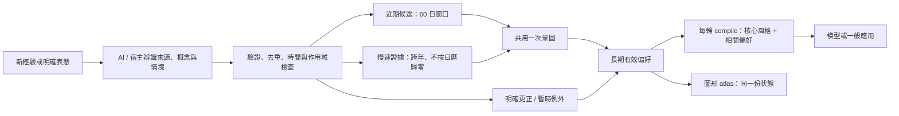

# Durable Preferences
## 給 AI 使用的長期偏好記憶 Skill

**可以忘記每頓飯的細節，但不應忘記一個人的口味。**

[English](README.en.md) · [方法與架構](docs/METHOD.md) · [圖像記憶研究](docs/IMAGE_MEMORY.md) · [安裝](docs/INSTALLATION.md) · [驗證與限制](docs/VALIDATION.md) · [參與討論](CONTRIBUTING.md)

**核心版本：v0.2.0｜狀態：研究原型｜執行環境：Python 3.10+ / SQLite / 標準函式庫**  
發起與需求設計：**紀順文**。實作與測試經 AI 輔助，接受公開檢視與反例。

## 這個專案是做什麼的？

Durable Preferences 是一套供 AI 代理掛載的**偏好記憶技能與可執行引擎**。
它把零散的體驗、明確喜惡與互動習慣，累積成可持續更新的狀態，讓新聊天或重啟後的 AI
不必重新閱讀整段歷史，仍能取得飲食口味、日常回覆風格、工作溝通方式等資訊。

目標不是把所有歷史逐字保存，也不是替特定角色寫人格設定。
核心想解決的是：**長期偏好能形成、能保留，而且人在改變時，記憶也能跟著改。**

> 使用者不需要每三天重新填寫「我喜歡什麼」。
> 但使用者說「我現在改了」，必須比舊偏好優先。

## 圖像記憶：已實作與正在研究，明確分開

本專案受到「某個概念的顏色隨經驗逐漸加深」的構想啟發，但不把單純出現次數當成喜愛程度。

| 路線 | v0.2.0 狀態 |
|---|---|
| 以概念與數值保存長期偏好，輸出同一狀態的色圖 | **已實作**：SQLite + JSON + HTML atlas |
| AI 使用 Skill 讀取結構化資料包 | **本地介面已實作**；真實模型的自動啟用與回答遵循尚未驗證 |
| 將狀態編碼為可精確解碼的圖片 | **研究提案，未實作** |
| 讓視覺模型只看圖片就讀懂記憶 | **研究提案，未驗證** |

目前的資料真值是結構化狀態，不是圖中的任意像素。
**不宣稱圖片已取代資料庫，不宣稱看圖一定更省 token，也不宣稱模型因此具有意識。**

## 方法概覽



更正直接更新長期狀態；暫時例外只覆蓋有效輸出，不改掉長期底色。

**兩條學習路徑，共用一次更新：**近期候選處理密集回饋；慢速證據保留最多 16 組未消費的獨立日摘要，
不因相隔三個月而歸零。慢速路徑至少 4 組、至少 75% 同方向才鞏固。
已有偏好以 `stable ← stable + 0.40 × (target − stable)` 更新；信心不會把學習率壓到零。

這些門檻是可重現的工程啟發式，不是心理測量，也不是通用最優參數。
細節與例外見 [METHOD.md](docs/METHOD.md) 及 [更新規則](references/update-rules.md)。

## 使用情境

| 輸入或問題 | 預期處理 |
|---|---|
| 「每隔幾個月才說一次這個很好吃」 | 稀疏正向體驗能跨年累積，不只增加熟悉度。 |
| 「今天中午吃過了，晚上先不要」 | 暫時例外，不抹掉長期喜愛。 |
| 「我現在已經不喜歡了」 | 明確更正立即生效，清掉更正前的學習候選。 |
| 「日常簡短，但工作要完整」 | 分情境保存，不用一個全域數值互相覆蓋。 |
| 「晚餐吃什麼？」 | 直接讀取適用偏好，不先掃七天或十年聊天。 |

人物的完整個性、醫療／過敏限制、一般事實考據與任務排程不是本版的替代範圍。

## 快速試跑

下載或複製專案後，進入 **durable-preferences** 目錄：

```bash
python examples/demo.py
python tests/run_all.py --unit-only
python tests/acceptance_v020.py --root . --out reports/local-run/acceptance.json
```

demo 使用虛構訊號與暫存資料庫；分類由範例預先標註，不呼叫真實 LLM。
完整套件要一起安裝，不是只複製 `SKILL.md`。
正式記憶庫必須放在 Git 專案之外，並由宿主綁定使用者身分。

```bash
# 先預覽；宿主確實掃描這個目錄時才套用
python scripts/install_skill.py --target "$HOME/.agents/skills"
python scripts/install_skill.py --target "$HOME/.agents/skills" --apply
```

不同宿主的技能路徑與自動觸發能力不同。此套件沒有替任何雲端帳號安裝插件，
也不是已部署的 MCP 服務。詳見 [安裝說明](docs/INSTALLATION.md)。

## 已測結果，不冒充完整產品驗收

| 項目 | v0.2.0 已保存的實測結果 |
|---|---|
| 單元與回歸 | 124 / 124；公開版整理時另行重跑通過 |
| 指定學習驗收 | 舊版 6 / 16 → v0.2.0 16 / 16；公開版另行重跑通過 |
| 季度正評 41 次 | 未知 → `+1.0000` |
| 已知 `+0.90` 後季度負評 41 次 | → `−0.9885` |
| 十年合成負載 | 實際 365,300 次寫入 + 365,300 次讀包 |
| 額外隨機迴圈 | 12 組 × 10,000 輪 |
| 36,530 同領域概念 | 本地暖快取 compile P95 約 0.96 ms |
| 指定十年主負載資料庫 | 約 31.31 MiB；完整去重憑證仍隨事件數成長 |

資料依據：[公開結果摘要](reports/repair-summary.json)、[本次發布前檢查](reports/publication-check/unit-tests.json)、
[獨立學習重跑](reports/publication-check/acceptance.json)。
效能是指定本地硬體與合成工作負載，不是雲端 SLA；公開整理沒有重跑整份十年負載。

**已知失敗仍保留：**50% 正負翻轉噪聲的 24 組探索測試中，4 組產生過強方向。
沒有真實自然語言分類、跨平台 Skill 啟用或最終回答遵循測試。
十年是模擬日曆與實際執行的資料量，不是觀察人類十年的實證。
詳見 [驗證與重現](docs/VALIDATION.md)。

## 歡迎一起研究「圖像能不能成為 AI 的長期記憶資產」

歡迎在 **Issues** 或儲存庫啟用後的 **Discussions** 分享反例、論文、編碼方案及最小原型。

我們尤其想比較：**結構化狀態、圖形／圖片編碼、視覺模型直接讀圖**。
比較必須用同一份輸入資料與任務，記錄資訊損失、修改成本、延遲、模型輸入成本及使用正確率。
也歡迎證明「這種情況不應該用圖片」，不以漂亮圖片取代實驗。

先讀 [圖像記憶研究議題](docs/IMAGE_MEMORY.md) 與 [RFC-0001 討論稿](docs/RFC-0001-image-memory.md)。
提案不必先有程式碼；**不要上傳真實私密對話、私人記憶庫、API 金鑰或他人的個資。**

## 專案內容

```text
SKILL.md                    AI 的使用規則
scripts/                    記憶核心、CLI、宿主接頭與遷移
references/                 API、編碼、更新、接入與驗收規格
examples/                   合成情境示範
tests/                      單元、驗收、長時間、密度與噪聲測試
reports/                    去識別化的既有測試與發布前結果
docs/                       方法、研究提案、驗證、發布說明
.github/ISSUE_TEMPLATE/     錯誤回報與圖像記憶提案格式
tools/publish_github.py     經驗證清單發布工具，預設僅預覽
```

## 隱私與授權狀態

本公開整理版不含真實對話、記憶資料庫、金鑰或個人帳務。測試資料均為合成；本地工作路徑已抽換，
原始資料來源雜湊與抽換規則記在 [PUBLICATION_PROVENANCE.json](PUBLICATION_PROVENANCE.json)。

**本專案採用 [MIT License](LICENSE) 開源授權。** 著作權 © 2026 紀順文。
允許使用、修改、商用及再發布（包含閉源版本），但須保留著作權與授權聲明。
軟體依現狀提供，不提供擔保。歡迎透過 Issues、Discussions 與 Pull Requests 參與；詳見 [貢獻說明](CONTRIBUTING.md)。
